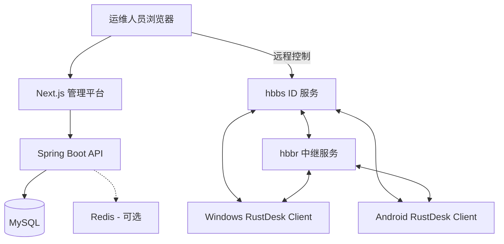

# 工业设备远程运维平台 — 系统设计文档（TDD）

**版本：** V1.1  
**设计原则：** RustDesk 为远程桌面基础，业务平台负责设备管理和用户管理。

> **需求修订（V1.1，2026-11-16）：** 第一版的目标改为“运维人员登录后，可直接选择已授权设备并进行远程控制”。不再限制为只读查看。会话录像和回放作为第二优先级能力：能录制则保留录像，并在归集成功后提供回放。

## 0. V1.1 实施决策（优先于下文相冲突的描述）

为实现“登录后直接远程控制”，第一版采用 **RustDesk Server Pro 自托管 + 具备 Web Client 使用条件的许可证**，而不是由业务平台自行实现浏览器远程控制协议。

原因是 Server Pro 已提供账号、设备管理、访问控制、审计和 Web Console；Web Client 可在浏览器中作为控制端。业务平台后续如有品牌化、工单或报表需求，再通过官方 API 做集成。这样 GLM 的工作范围明确为部署、配置和轻量业务整合，而非重写远程桌面。

### 0.1 第一版用户流程

1. 管理员部署自托管 RustDesk Server Pro，确认许可证已启用自托管 Web Client，并安装配置 Windows / Android 设备端客户端。
2. 管理员在 RustDesk Web Console 创建运维账号、登记设备，并给账号或用户组授予目标设备的控制权限。
3. 运维人员登录 RustDesk Web 门户，在设备列表中点击目标设备并在浏览器内开始远程控制。
4. 会话结束后，平台保留 RustDesk 审计记录；若本次会话录像已归集，则在会话详情中播放或下载录像。

### 0.2 本期范围

必须交付：

- 账号登录。
- 已授权设备列表及在线状态。
- 浏览器内发起 Windows / Android 设备远程控制。
- 设备分组与按组授权。
- 会话审计记录。

可选交付（不阻塞远程控制上线）：

- 自动启用会话录像。
- 将录像从控制端或受控端的指定目录归集至对象存储 / 文件服务器。
- 会话详情页按权限提供录像回放与下载。

明确不做：

- 自研屏幕采集、编码、P2P、NAT 穿透或中继协议。
- 将录像直接存入 MySQL。
- 生产工艺控制逻辑。

### 0.3 录像实现约束

RustDesk 客户端可启用会话录像并配置录像保存目录；Windows 服务端录像目录可配置为固定绝对路径。该能力只解决“产生录像文件”，不等同于“网页中集中回放”。

因此，录像功能按以下边界实现：

- 先完成远程控制与 RustDesk 自带的录像文件生成验证。
- Windows 设备的录像存放在受控、可备份的专用目录；Android 录像能力须在实机上验证后再纳入范围。
- 需要集中回放时，由独立归集任务将录像上传至对象存储或文件服务器，业务库只保存文件地址、大小、时长、校验值和访问权限。
- 未成功归集的录像只标记为“待归集 / 不可回放”，不得伪造为已有回放。

### 0.4 GLM 实施顺序

1. 使用 Docker 部署 RustDesk Server Pro、Nginx 和 HTTPS；配置 WebSocket / WSS。
2. 在一台 Windows 和一台 Android 真机上安装预配置客户端，验证登录、授权、浏览器远程控制及断线恢复。
3. 配置设备组、控制权限、禁用文件传输和其他不需要的高风险能力。
4. 启用并验证 Windows 会话录像文件；仅在此通过后，再开发录像归集与网页回放。
5. 最后才建设定制 Next.js / Spring Boot 门户；该门户应调用官方支持的能力，不能取代或模拟 RustDesk 媒体连接。

## 1. 总体架构

采用三个部分：

1. Web 业务管理平台。
2. RustDesk 远程通信服务。
3. Windows / Android 设备客户端。

### 1.1 架构图



注意：这是逻辑架构图，不代表 Web 浏览器可以直接使用原生 RustDesk 通信协议。浏览器远程控制入口必须使用 RustDesk Web Client，并满足对应产品能力和授权条件。

## 2. 技术选型

| 模块 | 技术 |
|---|---|
| 前端 | Next.js + TypeScript |
| UI | Ant Design |
| 后端 | Java 21 + Spring Boot |
| 数据库 | MySQL |
| 缓存 | Redis（按需） |
| 远程桌面 | RustDesk |
| ID 服务 | RustDesk hbbs |
| 中继服务 | RustDesk hbbr |
| 部署 | Docker + Nginx |

## 3. RustDesk 集成方案

### 3.1 基本原则

以 RustDesk 官方项目作为远程桌面底座。

参考：
- https://github.com/rustdesk/rustdesk
- https://github.com/rustdesk/rustdesk-server

不要重新实现：
- 屏幕采集。
- 视频编码。
- 视频传输。
- NAT 穿透。
- P2P 通信。
- 中继通信。

优先沿用上游客户端和服务端能力。

### 3.2 服务端

部署 RustDesk Server。

主要组件：

- hbbs：ID 注册及连接协商。
- hbbr：中继服务。

业务系统和 RustDesk 服务端保持独立部署。

### 3.3 客户端

Windows：
- 使用 RustDesk Windows 客户端。
- 配置自建服务端。
- 设备完成预先登记。
- 上报设备信息及运行状态。

Android：
- 使用 RustDesk Android 客户端。
- 配置自建服务端。
- 设备完成预先登记。
- 上报设备信息及运行状态。

不同操作系统的权限和屏幕采集能力由 RustDesk 原生客户端处理。

### 3.4 浏览器

浏览器承担：
- 用户登录。
- 设备列表。
- 设备管理。
- 远程画面展示。
- 会话状态展示。

优先验证 RustDesk 官方 Web Client。

Web Client 与 Web Console 是不同产品能力，不应混为一谈。

如果采用官方 Web Client，先确认对应授权、部署方式和功能限制。如果采用自定义浏览器集成，必须先确认官方支持的接口，不得假设存在未经验证的 API。

## 4. 后端模块设计

Spring Boot 只设置四个基础模块：

```text
com.example.remote
├── auth
│   ├── controller
│   ├── service
│   └── entity
├── device
│   ├── controller
│   ├── service
│   └── entity
├── session
│   ├── controller
│   ├── service
│   └── entity
└── audit
    ├── controller
    ├── service
    └── entity
```

### 4.1 auth 模块

负责：
- 用户登录。
- 用户身份验证。
- 角色权限。
- 登录状态。

### 4.2 device 模块

负责：
- 设备新增、修改、删除。
- 设备注册。
- RustDesk ID 关联。
- 设备在线状态。
- 设备分组。
- 设备详情。

### 4.3 session 模块

负责：
- 创建远程控制会话记录。
- 验证用户是否有权控制设备。
- 记录连接开始和结束。
- 记录异常断开。
- 维护会话状态。

### 4.4 audit 模块

负责：
- 用户登录日志。
- 设备管理日志。
- 会话查看日志。
- 权限变更日志。

## 5. 数据库设计

第一版只设计六张核心表。

### sys_user

| 字段 | 类型 | 说明 |
|---|---|---|
| id | BIGINT | 主键 |
| username | VARCHAR(64) | 用户名 |
| password | VARCHAR(255) | 密码哈希 |
| role | VARCHAR(32) | ADMIN / USER |
| status | TINYINT | 用户状态 |
| created_at | DATETIME | 创建时间 |

### device

| 字段 | 类型 | 说明 |
|---|---|---|
| id | BIGINT | 主键 |
| device_code | VARCHAR(64) | 设备编号 |
| device_name | VARCHAR(128) | 设备名称 |
| device_type | VARCHAR(32) | WINDOWS / ANDROID |
| rustdesk_id | VARCHAR(64) | RustDesk ID |
| group_id | BIGINT | 分组 ID |
| agent_version | VARCHAR(32) | Agent 版本 |
| status | VARCHAR(32) | 设备状态 |
| last_online_time | DATETIME | 最后在线时间 |
| created_at | DATETIME | 创建时间 |

### device_group

| 字段 | 类型 | 说明 |
|---|---|---|
| id | BIGINT | 主键 |
| group_name | VARCHAR(128) | 分组名称 |
| description | VARCHAR(255) | 描述 |
| created_at | DATETIME | 创建时间 |

### device_credential

| 字段 | 类型 | 说明 |
|---|---|---|
| id | BIGINT | 主键 |
| device_id | BIGINT | 设备 ID |
| credential_reference | VARCHAR(255) | 凭证安全存储引用 |
| status | TINYINT | 凭证状态 |
| created_at | DATETIME | 创建时间 |

实际凭证应使用安全存储或加密密钥管理，不保存明文密码。

### remote_session

| 字段 | 类型 | 说明 |
|---|---|---|
| id | BIGINT | 主键 |
| session_code | VARCHAR(64) | 会话编号 |
| user_id | BIGINT | 用户 ID |
| device_id | BIGINT | 设备 ID |
| start_time | DATETIME | 开始时间 |
| end_time | DATETIME | 结束时间 |
| duration | BIGINT | 持续秒数 |
| status | VARCHAR(32) | 会话状态 |

### audit_log

| 字段 | 类型 | 说明 |
|---|---|---|
| id | BIGINT | 主键 |
| user_id | BIGINT | 用户 ID |
| action | VARCHAR(64) | 操作类型 |
| target_id | VARCHAR(64) | 目标对象 |
| description | VARCHAR(512) | 操作描述 |
| created_at | DATETIME | 操作时间 |

所有表根据实际项目统一补充更新时间、索引和必要的唯一约束。

## 6. 核心接口设计

以下是业务接口建议，具体命名可以根据现有代码风格调整。

### 用户接口

```text
POST /api/auth/login
GET  /api/auth/me
POST /api/auth/logout
```

### 设备接口

```text
GET    /api/devices
GET    /api/devices/{id}
POST   /api/devices
PUT    /api/devices/{id}
DELETE /api/devices/{id}
GET    /api/devices/{id}/status
GET    /api/devices/groups
```

### 会话接口

```text
POST /api/sessions
GET  /api/sessions
GET  /api/sessions/{id}
POST /api/sessions/{id}/end
```

会话接口负责业务鉴权和记录，不能假定它本身就是 RustDesk 媒体连接接口。

### 审计接口

```text
GET /api/audit-logs
```

## 7. 核心状态设计

设备状态：

```text
ONLINE
OFFLINE
DISABLED
```

会话状态：

```text
CONNECTING
VIEWING
ENDED
FAILED
INTERRUPTED
```

设备心跳超时后，平台应将设备状态改为 OFFLINE。

网络连接异常后，结束会话并记录异常原因。

## 8. 前端页面结构

```text
app/
├── login/
├── dashboard/
├── devices/
│   ├── page.tsx
│   └── [id]/
├── sessions/
├── users/
└── audit-logs/
```

### Dashboard

展示：
- 设备总数。
- 在线设备。
- 离线设备。
- 当前查看会话数。

### Devices

设备表格：
- 设备名称。
- 设备编号。
- 操作系统。
- RustDesk ID。
- 在线状态。
- 最后在线时间。
- 查看详情。

### Remote Viewer

远程画面区域：
- 远程屏幕。
- 画面缩放。
- 全屏。
- 网络连接状态。
- 结束查看。

对已获控制权限的设备提供鼠标、键盘或触控输入；系统不实现任何生产工艺控制协议或自动化控制逻辑。

## 9. 安全设计

- 设备首次登记必须经过管理授权。
- 不允许未登记的设备自动成为可信设备。
- 用户只能查看或控制权限范围内的设备。
- 所有连接必须经过身份和设备授权检查。
- 不在浏览器保存长期设备认证凭证。
- 远程通信使用加密连接。
- 设备被禁用后立即禁止建立新会话。
- 会话终止后撤销临时访问授权。
- 记录所有设备访问行为。

## 10. 开发实施顺序

### 第一步：RustDesk 技术验证

使用原版客户端和自建 RustDesk Server，验证：
- Windows 设备连接。
- Android 设备连接。
- 浏览器端 Web Client。
- 浏览器远程控制。
- 部署所需的授权及版本条件。

### 第二步：基础业务平台

开发：
- 登录。
- 用户管理。
- 设备管理。
- 设备分组。
- 设备在线状态。

### 第三步：远程查看集成

将验证成功的 RustDesk Web 能力接入设备详情页。

### 第四步：会话记录与审计

完成会话开始、结束、异常状态记录。

### 第五步：部署测试

使用 Docker Compose 部署：
- Web。
- Java API。
- MySQL。
- RustDesk hbbs。
- RustDesk hbbr。

完成 Windows / Android 实机验证。

## 11. 关键设计原则

1. RustDesk 是底层远程桌面技术，不重新发明远程桌面协议。
2. Web 管理平台和远程通信服务分离。
3. 业务系统不直接处理视频编码和媒体中继。
4. 优先最少改动 RustDesk 上游项目。
5. 保持业务模块简单，不为第一版设计复杂的微服务。
6. 所有未验证的 RustDesk 功能必须先做 PoC。
7. 保留上游许可证声明及修改记录，发布修改版本前完成 AGPL-3.0 合规评估。
8. 当前版本定位为设备远程控制和运维管理，不接入生产工艺控制。
